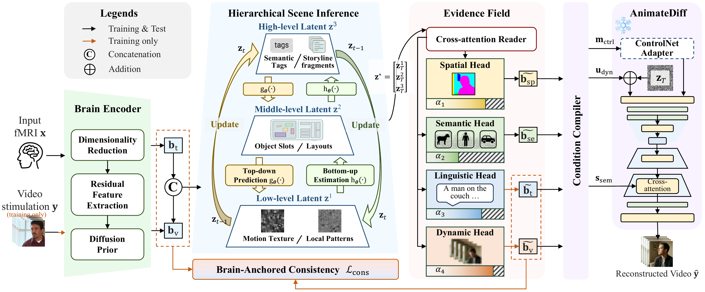
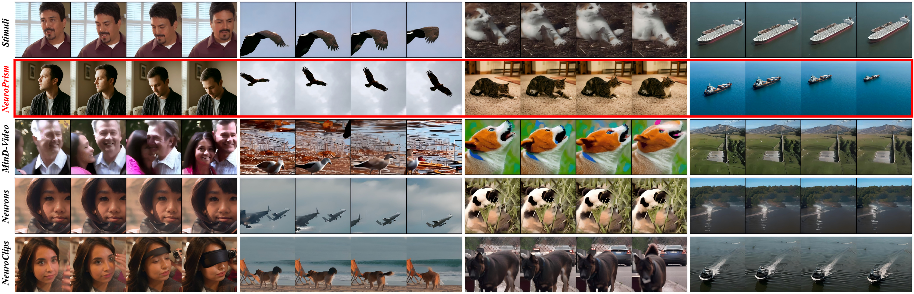

# 🧠 NeuroPrism

**NeuroPrism** is a reliability-aware hierarchical decoding system for reconstructing videos from fMRI signals. It refines scene representations through predictive coding, decodes spatial, semantic, linguistic, and dynamic evidence, and adaptively weights each channel by its estimated reliability to guide video generation, preserving visual structure, semantic content, and motion across reconstructed frames.

## 🧩 Overview

*Hierarchical scene inference, multi-channel evidence decoding, and reliability-aware conditioning for video reconstruction.*

## 🎬 Results

*Video reconstruction on cc2017. NeuroPrism results are outlined in red.*

## 🔗 Datasets

- **cc2017:** [Original data](https://purr.purdue.edu/publications/2809/1) · [Preprocessed data](https://huggingface.co/datasets/gongzx/cc2017_dataset)
- **HCP:** [1200 Subjects Data Release](https://www.humanconnectome.org/study/hcp-young-adult/document/1200-subjects-data-release)
- **Algonauts 2021:** [Dataset and challenge](https://algonautsproject.com/2021/challenge.html)
